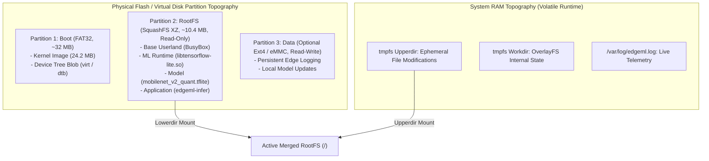

# Edge Deployment & Operations Guide
**Project:** EdgeML Linux OS  
**Distribution Track:** Track A – ML Inference at the Edge  
**Target Platform:** ARM64 (`aarch64` QEMU `virt` machine / ARMv8-A Edge Gateways)  
**Document Reference:** `documentation/DEPLOYMENT.md`  
**Date:** November 19, 2026  

---

## 1. Deployment Architecture & Storage Topography

EdgeML Linux OS is designed for deployment onto resource-constrained embedded edge hardware and virtualized cloud-edge nodes. Its read-only root filesystem architecture provides exceptional resilience against sudden power loss, storage corruption, and field tampering.



---

## 2. Production Deployment Targets

### 2.1 Virtualized Edge Deployment (QEMU ARM64)
* **Target Node:** QEMU `virt` platform running on Linux edge servers or hypervisors.
* **Launch Command:**
  ```bash
  qemu-system-aarch64 \
      -M virt -cpu cortex-a57 -smp 4 -m 1024M \
      -kernel Image \
      -drive file=rootfs.squashfs,format=raw,if=virtio,readonly=on \
      -append "root=/dev/vda ro console=ttyAMA0 quiet" \
      -nographic
  ```

### 2.2 Physical Edge Hardware Deployment (e.g., Cortex-A53/A57/A72 SBCs)
* **Flash Flashing (Raw Block Device)**:
  ```bash
  # Flash compressed read-only root partition to target block device
  sudo dd if=output_qemu/images/rootfs.squashfs of=/dev/mmcblk0p2 bs=4M status=progress conv=fsync
  ```
* **Bootloader Configuration (`u-boot.bin`)**:
  ```ini
  setenv bootargs "root=/dev/mmcblk0p2 ro rootfstype=squashfs console=ttyAMA0,115200 quiet"
  booti ${kernel_addr} - ${fdt_addr}
  ```

---

## 3. Operational Monitoring & Service Control

Once deployed, the device autonomously starts the image classification engine via `/etc/init.d/S90edgeml`. Operations personnel can manage the service via serial console or SSH (if provisioned):

```bash
# Check daemon operational status
/etc/init.d/S90edgeml status

# View live inference telemetry and latency logs
tail -f /var/log/edgeml.log

# Gracefully restart the inference service
/etc/init.d/S90edgeml restart

# Terminate the inference service
/etc/init.d/S90edgeml stop
```

---

## 4. Power Loss Resilience & Factory Reset Guarantee

* **Zero Persistent Wear**: Because the root filesystem is mounted strictly read-only (`ro`), write amplification on flash memory cells is reduced to zero.
* **Instant Factory Reset**: If the system is compromised, crashes, or becomes corrupted in memory, a simple hardware power cycle or reboot immediately purges the volatile `tmpfs` layer. The operating system reboots in **under 2 seconds** into its pristine, cryptographically signed factory state.
