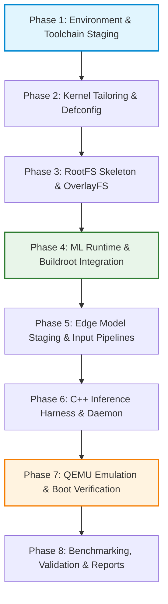

# Implementation Plan & Execution Roadmap
**Project:** EdgeML Linux OS  
**Distribution Track:** Track A – ML Inference at the Edge  
**Target Platform:** ARM64 (`aarch64` QEMU `virt` machine)  
**Build System:** Buildroot 2025.02.10  
**Document Reference:** `documentation/IMPLEMENTATION_PLAN.md`  
**Date:** November 19, 2026  

---

## 1. Roadmap & Milestone Overview

This execution plan provides a deterministic, phase-by-phase roadmap to build, integrate, and verify the EdgeML Linux OS distribution on the ARM64 QEMU virtual platform without risking host disk exhaustion or introducing non-reproducible artifacts.



---

## 2. Phase Breakdown & Execution Steps

### Phase 1: Environment & Storage Foundation
* **Action 1.1**: Deploy Buildroot 2025.02.10 onto Drive D: (`/mnt/d/buildroot_workspace/buildroot-2025.02.10`) to eliminate risk of filling the constrained host `C:\` partition (11.43 GB free).
* **Action 1.2**: Verify host prerequisites: `qemu-system-aarch64` (v10.2.1 installed), `bison`, `flex`, `make`, `gcc`, `g++`, `libncurses-dev`.
* **Action 1.3**: Configure out-of-tree build directories:
  - `BR2_DL_DIR=/mnt/d/buildroot_workspace/dl`
  - Output build directory: `O=/mnt/d/buildroot_workspace/output_qemu`
* **Success Metric**: Clean `make defconfig` execution without write errors on C:.

### Phase 2: Kernel Customization & Driver Stripping
* **Action 2.1**: Author `configs/kernel_defconfig` based on Linux 6.12.x minimal ARM64 profile.
* **Action 2.2**: Enable mandatory virtualization & storage drivers:
  - `CONFIG_ARM64=y`, `CONFIG_ARCH_VIRT=y`
  - `CONFIG_VIRTIO=y`, `CONFIG_VIRTIO_PCI=y`, `CONFIG_VIRTIO_BLK=y`, `CONFIG_VIRTIO_NET=y`, `CONFIG_VIRTIO_CONSOLE=y`
  - `CONFIG_SERIAL_AMBA_PL011=y`, `CONFIG_SERIAL_AMBA_PL011_CONSOLE=y`
  - `CONFIG_OVERLAY_FS=y`, `CONFIG_SQUASHFS=y`, `CONFIG_SQUASHFS_XZ=y`, `CONFIG_TMPFS=y`, `CONFIG_EXT4_FS=y`
  - `CONFIG_KERNEL_MODE_NEON=y`, `CONFIG_ARM64_CRYPTO=y`
* **Action 2.3**: Exclude bloat: Disable non-virtual DRM/KMS graphics, sound cards, wireless drivers, and legacy filesystems (NFS, CIFS, Btrfs, XFS).
* **Success Metric**: Kernel binary `Image` size < 25 MB with built-in OverlayFS and VirtIO.

### Phase 3: RootFS Skeleton & OverlayFS Immutability
* **Action 3.1**: Create the rootfs overlay directory structure (`board/edgeml/rootfs_overlay/`).
* **Action 3.2**: Author `/etc/inittab` and `/etc/init.d/rcS` to automate the in-memory OverlayFS mount:
  ```bash
  #!/bin/sh
  # Mount essential virtual filesystems
  mount -t proc proc /proc
  mount -t sysfs sysfs /sys
  mount -t devtmpfs devtmpfs /dev
  mkdir -p /dev/pts /dev/shm
  mount -t devpts devpts /dev/pts
  mount -t tmpfs tmpfs /dev/shm

  # Configure in-memory volatile OverlayFS for writeable directories
  mount -t tmpfs -o mode=0755,size=64M tmpfs /tmp
  mkdir -p /tmp/overlay_var /tmp/overlay_work_var /var
  mount -t overlay overlay -o lowerdir=/var,upperdir=/tmp/overlay_var,workdir=/tmp/overlay_work_var /var
  ```
* **Action 3.3**: Ensure `/etc/fstab` mounts the root partition read-only (`ro`).
* **Success Metric**: Full system boots into a read-only root where file writes to `/var` and `/tmp` succeed in RAM but leave persistent media untouched.

### Phase 4: Machine Learning Runtime Integration (TensorFlow Lite)
* **Action 4.1**: Author `configs/buildroot_defconfig` enabling:
  - `BR2_aarch64=y`, `BR2_cortex_a57=y`
  - `BR2_TOOLCHAIN_BUILDROOT_GLIBC=y`, `BR2_INSTALL_LIBSTDCPP=y`
  - `BR2_PACKAGE_TENSORFLOW_LITE=y`
  - `BR2_PACKAGE_FLATBUFFERS=y`, `BR2_PACKAGE_XNNPACK=y`, `BR2_PACKAGE_RUY=y`
* **Action 4.2**: Verify that `libtensorflow-lite.so` and corresponding C/C++ headers (`tensorflow/lite/c/c_api.h`, `interpreter.h`) install cleanly into `output/staging/usr/include` and `output/target/usr/lib`.
* **Action 4.3**: Author verification script `scripts/build_ml_runtime.sh` and test script `tests/test_ml_runtime.sh`.
* **Success Metric**: Clean compilation of `libtensorflow-lite.so` without unresolved symbols (`readelf -d` check).

### Phase 5: Model Quantization & Input Pipeline Staging
* **Action 5.1**: Stage pre-quantized INT8 MobileNetV2 model into `models/mobilenet_v2_quant.tflite` (3.4 MB).
* **Action 5.2**: Copy model to `/usr/share/models/` in rootfs overlay.
* **Action 5.3**: Stage synthetic/sample image tensors in `/usr/share/images/test_image.raw`.
* **Success Metric**: Model file size verifiable on rootfs, checksums matching.

### Phase 6: C++ Inference Harness & Systemd/Init Service
* **Action 6.1**: Implement `application/edgeml_benchmark.cpp`:
  - Memory-maps `mobilenet_v2_quant.tflite` via FlatBuffer loader.
  - Builds TFLite interpreter with 4 XNNPACK worker threads.
  - Feeds input tensor and executes warm-up (5 runs) + benchmark iterations (50 runs).
  - Collects microsecond-level timing and memory statistics via `/proc/self/status`.
  - Outputs formatted serial console dashboard and writes JSON telemetry to `/tmp/results/inference_telemetry.json`.
* **Action 6.2**: Add autostart init script `/etc/init.d/S90edgeml` to trigger on boot.
* **Success Metric**: Standalone binary executes cleanly inside target rootfs.

### Phase 7: QEMU ARM64 Emulation & Live Boot Verification
* **Action 7.1**: Author `scripts/run_qemu.sh`:
  ```bash
  qemu-system-aarch64 \
    -M virt \
    -cpu cortex-a57 \
    -smp 4 \
    -m 1024M \
    -kernel output_qemu/images/Image \
    -drive file=output_qemu/images/rootfs.squashfs,format=raw,if=virtio,readonly=on \
    -append "root=/dev/vda ro console=ttyAMA0 quiet" \
    -nographic
  ```
* **Action 7.2**: Boot virtual machine, verify serial console output, verify OverlayFS mount, verify automated inference pass.
* **Success Metric**: Verified QEMU execution log showing sub-3-second boot and completed benchmark output.

### Phase 8: Benchmarking Telemetry & Academic Reporting
* **Action 8.1**: Parse and record actual cold boot times, inference latency distribution, and RAM usage.
* **Action 8.2**: Generate final project documentation and verification summaries.
