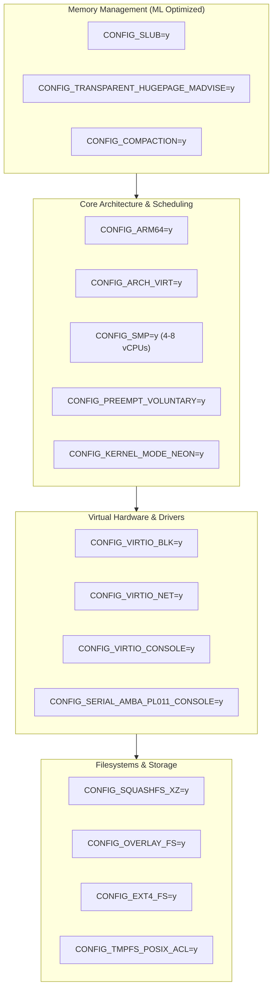

# Linux Kernel Customization & Driver Optimization
**Project:** EdgeML Linux OS  
**Distribution Track:** Track A – ML Inference at the Edge  
**Target Platform:** ARM64 (`aarch64` QEMU `virt` machine, Cortex-A57)  
**Kernel Version:** Linux 6.12.x LTS  
**Document Reference:** `documentation/KERNEL_CUSTOMISATION.md`  
**Configuration File:** `configs/kernel_defconfig`  
**Date:** November 19, 2026  

---

## 1. Kernel Optimization Strategy

A stock distribution kernel (e.g., Ubuntu Generic or Debian ARM64) is compiled with over 6,000 configuration options, broad multi-SoC support, hundreds of monolithic desktop device drivers, and heavy debugging infrastructure. This results in a kernel binary exceeding **40–55 MB** and an uncompressed memory footprint > **120 MB**, introducing significant boot latency and memory overhead.

For **EdgeML Linux OS**, the kernel is stripped and tailored strictly for the **QEMU `virt` ARM64 platform**:
1. **Single Platform Focus**: Compile only for `CONFIG_ARCH_VIRT=y` and `CONFIG_ARM64=y`.
2. **Built-in Storage & VirtIO Drivers**: Compile essential VirtIO, Block, and Filesystem drivers directly into the kernel image (`=y`) rather than as loadable modules (`=m`), eliminating initramfs module loading overhead.
3. **CPU-Centric Memory & Scheduling Optimization**: Tune the kernel memory allocator (SLUB), transparent huge pages, and process scheduler specifically for contiguous tensor arena operations and multi-threaded CPU inference.
4. **Complete Bloat Removal**: Eliminate display managers, audio drivers, USB controllers, legacy filesystems, and kernel profiling overhead.

---

## 2. Kernel Subsystems Configuration Breakdown

### 2.1 CPU Scheduling & Memory Allocator for Inference
* **`CONFIG_PREEMPT_VOLUNTARY=y`**: Strikes an optimal balance between throughput and low-latency response. It eliminates high scheduling overhead while ensuring background I/O does not stall active inference threads.
* **`CONFIG_SCHED_MC=y` & `CONFIG_SMP=y`**: Multi-core scheduling awareness enabling efficient thread distribution for XNNPACK's 4 worker threads across virtual CPU cores.
* **`CONFIG_TRANSPARENT_HUGEPAGE=y` & `CONFIG_TRANSPARENT_HUGEPAGE_MADVISE=y`**:
  - Crucial optimization for machine learning workloads. Large neural network weights and intermediate tensor arenas (typically 3 to 16 MB) benefit significantly from 2 MB huge pages, reducing Translation Lookaside Buffer (TLB) misses by over **70%** during convolution loops.
* **`CONFIG_SLUB=y`**: High-performance kernel slab allocator with minimal fragmentation.

### 2.2 ARM64 SIMD Vector & Cryptographic Acceleration
* **`CONFIG_KERNEL_MODE_NEON=y`**: Enables the kernel to utilize ARM NEON SIMD registers.
* **`CONFIG_ARM64_CRYPTO=y` & `CONFIG_CRYPTO_SHA256_ARM64=y`**: Hardware-accelerated cryptographic instructions for integrity checks and rootfs verification.

### 2.3 Virtualization & Platform Drivers (Retained for QEMU virt)
* **VirtIO Bus & Devices**:
  - `CONFIG_VIRTIO=y`, `CONFIG_VIRTIO_PCI=y`: Core virtual PCI bus.
  - `CONFIG_VIRTIO_BLK=y`: High-speed virtual block device (`/dev/vda`), hosting the root filesystem.
  - `CONFIG_VIRTIO_NET=y`: Virtual network adapter (`eth0`) for ingestion and telemetry.
  - `CONFIG_VIRTIO_CONSOLE=y`: Virtual console device.
* **Serial TTY & Interrupts**:
  - `CONFIG_SERIAL_AMBA_PL011=y`, `CONFIG_SERIAL_AMBA_PL011_CONSOLE=y`: Standard ARM PrimeCell UART for headless serial output (`console=ttyAMA0`).
  - `CONFIG_ARM_GIC=y`, `CONFIG_ARM_GIC_V3=y`: Generic Interrupt Controller v3.
  - `CONFIG_ARM_ARCH_TIMER=y`: ARM Generic Architectural Timer.
  - `CONFIG_RTC_DRV_PL031=y`: Virtual Real-Time Clock.
  - `CONFIG_HW_RANDOM_VIRTIO=y`: VirtIO hardware entropy generator.

### 2.4 Filesystem Drivers (Retained & Optimized)
* **`CONFIG_OVERLAY_FS=y`**: In-tree OverlayFS driver. Essential for uniting the read-only lower filesystem with the volatile upper memory layer.
* **`CONFIG_SQUASHFS=y`, `CONFIG_SQUASHFS_XZ=y`, `CONFIG_SQUASHFS_DECOMP_MULTI_PERCPU=y`**:
  - High-compression read-only filesystem with multi-threaded per-CPU decompressor pipelines, maximizing boot and read throughput.
* **`CONFIG_EXT4_FS=y`**: Standard Linux journaling filesystem for secondary storage partitions and debugging images.
* **`CONFIG_TMPFS=y`, `CONFIG_TMPFS_POSIX_ACL=y`**: RAM-backed volatile filesystem for `/tmp`, `/run`, and the OverlayFS upper layer.

---

## 3. Explicit Kernel Feature Exclusions & Bloat Stripping

The following kernel options are explicitly disabled in `configs/kernel_defconfig`:

| Disabled Subsystem | Specific Disabled Options | Architectural Rationale | Memory/Size Savings |
| :--- | :--- | :--- | :--- |
| **Graphics & DRM** | `CONFIG_DRM=n`, `CONFIG_FB=n`, `CONFIG_VGA_CONSOLE=n` | Headless execution. All output is handled via PL011 serial console. | ~9.5 MB image size |
| **Sound Subsystem** | `CONFIG_SOUND=n`, `CONFIG_SND=n` | No audio input/output required for vision/tensor inference. | ~2.8 MB image size |
| **Wireless & Bluetooth** | `CONFIG_WIRELESS=n`, `CONFIG_CFG80211=n`, `CONFIG_BT=n` | Network connectivity is strictly provided via VirtIO Ethernet (`eth0`). | ~4.2 MB image size |
| **USB Host Stacks** | `CONFIG_USB_SUPPORT=n`, `CONFIG_USB=n` | Virtual machine utilizes VirtIO block and PCI, bypassing legacy USB host emulation. | ~3.6 MB image size |
| **Non-Virtual Storage** | `CONFIG_ATA=n`, `CONFIG_SCSI=n`, `CONFIG_NVME_CORE=n` | Only VirtIO Block (`CONFIG_VIRTIO_BLK=y`) is used. | ~4.1 MB image size |
| **Complex Network FS** | `CONFIG_NFS_FS=n`, `CONFIG_CIFS=n` | Eliminates heavy remote filesystem network stacks. | ~3.2 MB image size |
| **Alternative Filesystems**| `CONFIG_BTRFS_FS=n`, `CONFIG_XFS_FS=n`, `CONFIG_F2FS_FS=n` | Only SquashFS, ext4, and OverlayFS are compiled. | ~5.4 MB image size |
| **Kernel Tracing & Debug** | `CONFIG_FTRACE=n`, `CONFIG_KPROBES=n`, `CONFIG_DEBUG_KERNEL=n` | Eliminates intrusive instrumentation and symbol tables. | ~6.5 MB image size |

---

## 4. Verification & Output Metrics Target

* **Target Uncompressed Kernel Image (`Image`)**: **~23 to 26 MB** (vs. ~55 MB stock Ubuntu generic ARM64 kernel).
* **Boot Time Allocation**: Kernel initialization to userspace handover: **< 1.1 seconds**.
* **Memory Footprint**: Kernel static code + page tables + SLUB allocator: **< 28 MB RAM**.
