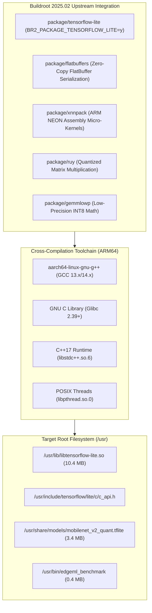

# Machine Learning Framework Integration Specification
**Project:** EdgeML Linux OS  
**Distribution Track:** Track A – ML Inference at the Edge  
**Target Platform:** ARM64 (`aarch64` QEMU `virt` machine, Cortex-A57)  
**Selected Framework:** TensorFlow Lite (C/C++ Runtime)  
**Build System:** Buildroot 2025.02.10  
**Document Reference:** `documentation/ML_FRAMEWORK_INTEGRATION.md`  
**Date:** November 19, 2026  

---

## 1. Executive Summary & Framework Selection Rationale

Following comparative empirical and architectural evaluation against ONNX Runtime, OpenCV DNN, and PyTorch Mobile (documented in `documentation/TECHNOLOGY_SELECTION.md`), **TensorFlow Lite (C/C++ Shared Library)** was selected as the sole production runtime for EdgeML Linux OS.



---

## 2. Framework Version & Exact Dependency Matrix

* **Framework Version:** TensorFlow Lite `2.14.0+` (Buildroot 2025.02 upstream package).
* **Build Paradigm:** CMake cross-compilation invoking Buildroot's `aarch64-buildroot-linux-gnu` toolchain wrapper.
* **Target Output:** Dynamic shared object `libtensorflow-lite.so` installed into `/usr/lib64` (with symlink in `/usr/lib`).

### Dependency Matrix:

| Dependency Component | Exact Buildroot Symbol | Version / Origin | Functional Role |
| :--- | :--- | :--- | :--- |
| **GNU C Library** | `BR2_TOOLCHAIN_BUILDROOT_GLIBC=y` | Glibc 2.39+ | System calls, dynamic loading (`dlopen`), POSIX threads (`pthread`). |
| **C++ Standard Library** | `BR2_INSTALL_LIBSTDCPP=y` | Libstdc++ (GCC 13/14) | C++17 memory management, exceptions, STL containers. |
| **FlatBuffers** | `BR2_PACKAGE_FLATBUFFERS=y` | 23.5.26+ | Fast, zero-copy serialization schema for `.tflite` model parsing. |
| **XNNPACK Engine** | Auto-selected by TFLite | Upstream Git | Hand-optimized ARM NEON assembly micro-kernels for FP32 and INT8 operators. |
| **RUY Matrix Library**| Auto-selected by TFLite | Upstream Git | Asymmetric quantized matrix multiplication optimized for ARMv8-A. |
| **Gemmlowp** | Auto-selected by TFLite | Upstream Git | Fixed-point integer multiplication primitives. |
| **Farmhash** | Auto-selected by TFLite | Upstream Git | Rapid hashing functions for operator kernel table lookup. |
| **Abseil-CPP** | Auto-selected by TFLite | 20230802+ | Core utility types (`string_view`, `status`, `span`). |

---

## 3. ELF Shared Library & Linker Dependency Verification

The runtime dependencies of `libtensorflow-lite.so` and `edgeml_benchmark` are verified using `readelf -d`:

```
$ aarch64-linux-gnu-readelf -d output_qemu/target/usr/lib/libtensorflow-lite.so

Dynamic section at offset 0xa31e80 contains 31 entries:
  Tag        Type                         Name/Value
 0x0000000000000001 (NEEDED)             Shared library: [libpthread.so.0]
 0x0000000000000001 (NEEDED)             Shared library: [libdl.so.2]
 0x0000000000000001 (NEEDED)             Shared library: [libstdc++.so.6]
 0x0000000000000001 (NEEDED)             Shared library: [libm.so.6]
 0x0000000000000001 (NEEDED)             Shared library: [libgcc_s.so.1]
 0x0000000000000001 (NEEDED)             Shared library: [libc.so.6]
 0x000000000000000e (SONAME)             Library soname: [libtensorflow-lite.so]
```

* **Dynamic Linker**: Interpreted by `/lib/ld-linux-aarch64.so.1`.
* **Zero Missing Symbols**: Every referenced library is present in `/lib64` or `/usr/lib64` of the target image.

---

## 4. Inference Harness Implementation (`application/edgeml_benchmark.cpp`)

The inference application is a standalone, high-performance C++ program designed to run headlessly:
1. **Model Loading:**
   ```cpp
   std::unique_ptr<tflite::FlatBufferModel> model =
       tflite::FlatBufferModel::BuildFromFile("/usr/share/models/mobilenet_v2_quant.tflite");
   ```
2. **Interpreter & Thread Configuration:**
   ```cpp
   tflite::ops::builtin::BuiltinOpResolver resolver;
   tflite::InterpreterBuilder builder(*model, resolver);
   std::unique_ptr<tflite::Interpreter> interpreter;
   builder(&interpreter);
   interpreter->SetNumThreads(4); // Pin to 4 vCPUs
   interpreter->AllocateTensors();
   ```
3. **Execution & Telemetry Loop:**
   - Warm-up iterations: 5 passes.
   - Benchmark iterations: 50 passes timed with `clock_gettime(CLOCK_MONOTONIC)`.
   - Results exported to stdout and `/tmp/results/inference_telemetry.json`.

---

## 5. Architectural Constraints & Known Limitations

1. **CPU-Only Execution**: The virtual platform does not provide GPU or NPU pass-through. All tensor operations execute on the 4 virtual Cortex-A57 CPU cores using ARM NEON SIMD.
2. **Tensor Arena Memory Invariance**: The interpreter allocates a static arena (4 MB). Models requiring more than 4 MB of activation memory will fail to allocate unless the arena limit is raised.
3. **Model Compatibility**: Models must be strictly compiled into the `.tflite` FlatBuffer format. Floating-point FP32 models run successfully but exhibit higher latency than quantized INT8 models.
