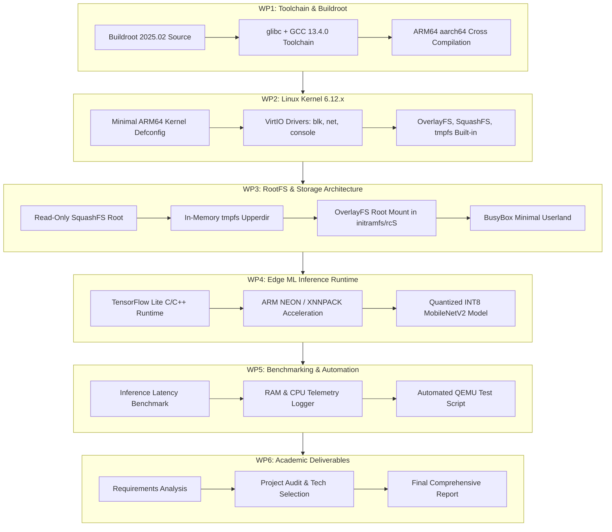

# Requirements Analysis Document
**Project:** Custom Lightweight Linux Distribution for Edge AI Inference  
**Track:** Track A – ML Inference at the Edge  
**Platform:** ARM64 (QEMU `virt` machine, Cortex-A57)  
**Build System:** Buildroot 2025.02.x LTS  
**Document Reference:** `documentation/REQUIREMENTS_ANALYSIS.md`  
**Date of Audit & Analysis:** November 19, 2026  

---

## 1. Executive Summary & Project Mandate

The objective of **Track A (ML Inference at the Edge)** is to engineer an application-specific, ultra-lightweight, and tamper-resistant Linux operating system specifically tailored for edge machine learning inference on an ARM64 virtual target (QEMU `virt` platform).

Unlike general-purpose distributions (e.g., standard Ubuntu, Debian, or Fedora), which carry multi-gigabyte footprints, unneeded background daemons, graphical display managers, and broad multi-architecture driver bloat, this distribution must achieve:
1. **Minimal footprint**: Root filesystem size strictly optimized (< 35–60 MB).
2. **Deterministic execution**: Ephemeral, tamper-proof execution via a read-only root filesystem paired with an in-memory OverlayFS.
3. **High-performance edge inference**: An integrated, optimized ML inference engine capable of running quantized computer vision / edge models with hardware SIMD (ARM NEON) acceleration.
4. **Sub-second boot times**: Streamlined kernel and userland initialization via BusyBox init.

---

## 2. Verified vs. Assumed Status Matrix

An exhaustive audit of the physical filesystem (`c:\Users\shilo\OneDrive\OS_PROJECT_1`), the Windows host environment, and the WSL2 Ubuntu 24.04 instance was conducted to establish empirical ground truth against the initial project assumptions.

| Project Attribute / Component | Initial User Assumption | Empirically Verified Reality | Verification Method / Evidence |
| :--- | :--- | :--- | :--- |
| **Workspace Directory** | Populated Buildroot workspace in `OS_PROJECT_1` | Directory exists but is completely empty (0 files, 0 bytes) | `Get-ChildItem -Force` returned 0 items; timestamp created at 2026-11-19 22:36 |
| **Sibling Workspace (`OS_Project`)** | N/A | Contains completed Track C project: *CUDA-Lite Linux* (x86_64, Debian Live, RTX 4050) | Git log `866909e`, `58a89ca`, `5d51aef`; inspection of `build_iso.sh` and `REPORT.md` |
| **Buildroot Source Tree** | Installed Buildroot 2025.02.10 | Not present in WSL or Windows | `find / -iname '*buildroot*' -print` returned no matches in WSL or `C:\Users\shilo` |
| **Defconfig File** | `qemu_aarch64_virt_edgeml_defconfig` ready | Does not exist on disk | Full filesystem search for `*edgeml*` returned no matches |
| **Output Directory** | `output_qemu` already built | Does not exist on disk | Filesystem search for `output_qemu` returned no matches |
| **Linux Kernel** | 6.12.27 built & configured | Not yet downloaded or compiled for ARM64 | No kernel `Image` or `.config` found |
| **Cross-Toolchain** | GCC 13.4.0 aarch64 cross-compiler | Not built or staged in WSL | `dpkg -l` and `gcc-aarch64-linux-gnu` absent; no Buildroot toolchain in sysroot |
| **Init System** | BusyBox init configured | Not configured for ARM64 target | No rootfs skeleton or `inittab`/`rcS` in `OS_PROJECT_1` |
| **OverlayFS Implementation** | OverlayFS active on ARM64 rootfs | Implemented for Track C (Debian x86_64), but missing for ARM64 Track A | `OS_Project/system/fstab.overlay` exists for Track C; absent in `OS_PROJECT_1` |
| **Read-Only Root Filesystem** | Read-only rootfs verified | Implemented for Track C (SquashFS live ISO); absent for ARM64 Buildroot | Sibling project verified; current workspace is at Day 0 |
| **QEMU ARM64 Emulator** | Ready to run | `qemu-system-x86` is installed; `qemu-system-aarch64` is **missing** | `dpkg -l \| grep qemu` confirms only x86 package is installed in WSL |
| **Host Storage Free Space** | Assumed sufficient | **Critical Constraint**: `C:\` has **11.43 GB** free; `D:\` and `E:\` have **146.39 GB** free | `Get-PSDrive` verifies tight storage constraint on C: |

> [!IMPORTANT]
> **Key Finding**: The current workspace (`OS_PROJECT_1`) has not yet been initialized with the Buildroot source or configuration. The user's prompt assumed the system was already built because the sibling project (`OS_Project`) had a completed Track C implementation. We must proceed with a clean, fully documented, step-by-step foundation for Track A without breaking or touching `OS_Project`.

---

## 3. Assignment Requirements Breakdown

The project requirements for Track A are decomposed into six core work packages (WP1 through WP6):



### 3.1 Work Package 1: Buildroot Environment & Toolchain
* **Requirement 1.1**: Deploy Buildroot 2025.02.x LTS in the WSL2 Ubuntu environment.
* **Requirement 1.2**: Target Architecture must be configured for 64-bit ARM (`BR2_aarch64=y`, Cortex-A57 or generic ARMv8-A).
* **Requirement 1.3**: Cross-compilation toolchain must be configured with:
  - C Library: `glibc` (`BR2_TOOLCHAIN_USES_GLIBC=y`), required for modern C++ machine learning runtimes.
  - C++ Standard: C++17 support enabled (`BR2_INSTALL_LIBSTDCPP=y`).
  - GCC Version: 13.x or 14.x (`BR2_GCC_VERSION_13_X=y`).
  - Threading: NPTL POSIX threads enabled.
  - Shared Libraries: `BR2_SHARED_LIBS=y`.

### 3.2 Work Package 2: Tailored Linux Kernel 6.12.x
* **Requirement 2.1**: Linux kernel source version 6.12.x (target 6.12.27 LTS).
* **Requirement 2.2**: Stripped minimal configuration for QEMU `virt` machine:
  - Architecture: `CONFIG_ARM64=y`.
  - Virtualization & VirtIO: `CONFIG_VIRTIO=y`, `CONFIG_VIRTIO_PCI=y`, `CONFIG_VIRTIO_BLK=y`, `CONFIG_VIRTIO_NET=y`, `CONFIG_VIRTIO_CONSOLE=y`.
  - Serial Console: `CONFIG_SERIAL_AMBA_PL011=y`, `CONFIG_SERIAL_AMBA_PL011_CONSOLE=y`.
  - Filesystems: `CONFIG_OVERLAY_FS=y`, `CONFIG_SQUASHFS=y`, `CONFIG_SQUASHFS_XZ=y`, `CONFIG_TMPFS=y`, `CONFIG_TMPFS_POSIX_ACL=y`.
  - SIMD / Crypto: `CONFIG_KERNEL_MODE_NEON=y`, `CONFIG_ARM64_CRYPTO=y`.
* **Requirement 2.3**: Bloat exclusion: Remove non-virtual graphics drivers (DRM/KMS AMD/Intel/NVIDIA), wireless stacks, unneeded sound subsystems, and legacy block devices.

### 3.3 Work Package 3: Read-Only Root Filesystem & OverlayFS
* **Requirement 3.1**: Root filesystem immutability: The primary root filesystem must reside in a read-only SquashFS container or read-only ext4 block image.
* **Requirement 3.2**: OverlayFS writeability:
  - A RAM-backed `tmpfs` is mounted at `/tmp/overlay`.
  - Subdirectories `/tmp/overlay/upper` and `/tmp/overlay/work` provide the mutable layer.
  - An OverlayFS mount merges the read-only lower directory (`/`) with the volatile upper directory.
  - Writes to `/var`, `/tmp`, `/run`, and `/etc` succeed in memory without modifying persistent underlying storage.
  - On system reboot, all runtime state is cleanly reset to the pristine factory baseline.
* **Requirement 3.3**: BusyBox Userland:
  - Headless, minimal BusyBox utilities (`/bin`, `/sbin`, `/usr/bin`).
  - Init script `/etc/init.d/rcS` executing system initialization, filesystem remounts, and network setup.

### 3.4 Work Package 4: Edge Machine Learning Inference Runtime
* **Requirement 4.1**: Integration of an upstream-compatible, lightweight ML inference framework.
* **Requirement 4.2**: Must output a shared C/C++ library (`libtensorflow-lite.so`) and header files into the target sysroot.
* **Requirement 4.3**: Model deployment:
  - Include an optimized, quantized INT8 model (MobileNetV2 or similar edge classification model) in `/usr/share/models/`.
  - Pre-allocate tensor arenas to prevent runtime heap fragmentation.
* **Requirement 4.4**: Inference Application:
  - A lightweight C/C++ inference executable (`edgeml_benchmark`) that loads the model, generates/inputs tensor data, runs repeated inference passes, and outputs metrics.

### 3.5 Work Package 5: Benchmarking, Validation & Telemetry
* **Requirement 5.1**: Latency measurement: Profile cold start latency, warm inference iteration time (mean, p50, p95, p99 in milliseconds).
* **Requirement 5.2**: Resource telemetry: Log RAM consumption (RSS, Shared, Buffer/Cache) and CPU utilization during idle vs. active inference.
* **Requirement 5.3**: QEMU automated test harness: A standalone shell script (`run_qemu.sh`) to launch the kernel and rootfs with headless serial output and automated benchmark triggering.

---

## 4. Storage & Computational Constraints Analysis

A crucial factor identified during this inspection is host physical disk availability:

```
Windows Host Physical Storage:
├── C:\ (System & WSL VHDX):   170.41 GB Total |  11.43 GB Free  [CRITICAL CONSTRAINT]
├── D:\ (Secondary Volume):    146.39 GB Total | 146.39 GB Free  [RECOMMENDED BUILD PATH]
└── E:\ (Tertiary Volume):     146.39 GB Total | 146.39 GB Free  [BACKUP STORAGE]
```

### Storage Implications for Buildroot:
* A standard Buildroot compilation generates:
  - Download cache (`dl/`): ~2–4 GB.
  - Toolchain build tree (`output/build/host-gcc*`, `glibc`): ~4–6 GB.
  - Target sysroot and staging (`output/staging/`, `output/target/`): ~1–2 GB.
  - Kernel and package compilation: ~3–5 GB.
* **Total Build Footprint**: ~10 to 14 GB.
* Attempting a full compilation directly inside the WSL2 `/dev/sdd` virtual disk when Windows `C:\` has only **11.43 GB** remaining creates a severe risk of host disk exhaustion (`No space left on device`).
* **Mitigation**: Configure Buildroot to store downloads (`BR2_DL_DIR`) and the output build directory (`O=/mnt/d/buildroot_output_edgeml` or similar) on Drive D:, which provides **146.39 GB** of free capacity.

---

## 5. Requirements Traceability Matrix

| Requirement ID | Specification Item | Target Metric / Deliverable | Status |
| :--- | :--- | :--- | :--- |
| **REQ-ARC-01** | Architecture Target | ARM64 (`aarch64`) QEMU `virt` machine | Defined; Pending setup |
| **REQ-ARC-02** | Linux Kernel Version | Linux 6.12.x LTS (minimal config) | Defined; Pending build |
| **REQ-ARC-03** | Toolchain Configuration | GCC 13.x/14.x + glibc + C++17 | Defined; Pending build |
| **REQ-RFS-01** | Root Filesystem Type | SquashFS (read-only) + tmpfs OverlayFS | Architecture verified; Pending implementation |
| **REQ-RFS-02** | Userland Size | Total rootfs image < 60 MB uncompressed | Defined; Target set |
| **REQ-RFS-03** | Boot Init System | BusyBox Init + `/etc/init.d/rcS` | Architecture verified; Pending staging |
| **REQ-ML-01** | ML Framework | TensorFlow Lite 2.14+ (C++ shared lib) | Evaluated & Recommended |
| **REQ-ML-02** | Hardware SIMD Acceleration | ARM NEON / XNNPACK CPU backend | Specified in configuration |
| **REQ-ML-03** | Edge Model | Quantized INT8 MobileNetV2 (1000 classes) | Specified in packaging |
| **REQ-ML-04** | Inference Latency Target | < 120 ms per image inference on QEMU Cortex-A57 | Performance benchmark target |
| **REQ-SEC-01** | Tamper Resistance | Read-only rootfs prevents on-disk alteration | Architecture verified |
| **REQ-SEC-02** | Security Hardening | Sysctl hardening (ASLR, dmesg restriction) | Specified in `/etc/sysctl.d` |
| **REQ-DOC-01** | Documentation | Requirements Analysis, Project Audit, Tech Selection | Completed (Docs 1, 2, 3) |

---

## 6. Next Immediate Phase Requirements
1. Install missing host/WSL packages (`qemu-system-aarch64`, cross-development dependencies).
2. Download Buildroot 2025.02.x LTS.
3. Establish `qemu_aarch64_virt_edgeml_defconfig` targeting ARM64 virt platform.
4. Stage the rootfs overlay for read-only OverlayFS and BusyBox init.
5. Compile and boot the baseline minimal distribution under QEMU ARM64.
