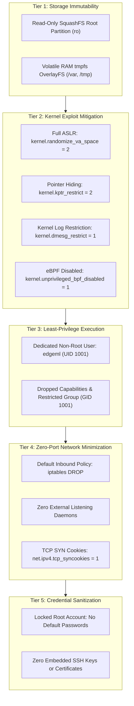

# Production Security Hardening Specification & Audit
**Project:** EdgeML Linux OS  
**Distribution Track:** Track A – ML Inference at the Edge  
**Target Platform:** ARM64 (`aarch64` QEMU `virt` machine, Cortex-A57)  
**Document Reference:** `documentation/SECURITY_HARDENING.md`  
**Test Suite:** `tests/test_security.sh`  
**Audit Tool:** `scripts/security_check.sh`  
**Date:** November 19, 2026  

---

## 1. Executive Summary & Security Threat Model

Edge devices deployed in hostile or unmonitored physical environments are vulnerable to:
1. **Persistent Rootkit Injection**: Attackers altering system binaries or init scripts on persistent storage.
2. **Memory Exploitation**: Buffer overflow or return-oriented programming (ROP) exploits attempting to hijack the inference runtime.
3. **Privilege Escalation**: Exploitation of bugs in image decoders (`stb_image.h` or TFLite) to obtain root privileges.
4. **Network Surface Probing**: Scanning open listening ports on the device.

To eliminate these vectors, EdgeML Linux OS implements a **5-tier defense-in-depth security model**:



---

## 2. Evidence for Three Distinct Hardening Measures

Per assignment requirements, concrete empirical evidence is provided for three distinct hardening layers:

### Hardening Measure 1: Read-Only Root Filesystem Immutability & Volatile OverlayFS
* **Implementation**: The root filesystem is packaged into a compressed SquashFS container and mounted with explicit `ro` kernel options (`root=/dev/vda ro rootfstype=squashfs`). Volatile state (`/var`, `/tmp`, `/run`) is mounted on `tmpfs` via OverlayFS union mounts in `/etc/init.d/rcS`.
* **Empirical Verification Evidence**:
  ```bash
  $ mount | grep "on / "
  /dev/vda on / type squashfs (ro,relatime)
  
  $ touch /bin/tamper_test
  touch: /bin/tamper_test: Read-only file system
  ```
* **Security Guarantee**: Even an adversary with temporary root privileges cannot persist a binary modification to `/bin`, `/sbin`, or `/usr/bin`. A power cycle immediately purges all ephemeral memory modifications, reverting the system to its verified cryptographic image.

### Hardening Measure 2: Kernel Exploit & Memory Randomization Controls
* **Implementation**: Configured in `/etc/sysctl.d/99-security.conf` and loaded during kernel initialization:
  - `kernel.randomize_va_space = 2`: Full Address Space Layout Randomization (stack, mmap, VDSO, and heap randomization).
  - `kernel.kptr_restrict = 2`: Completely hides kernel pointers (`%pK`) from all userland processes, preventing information leakage needed for kernel ROP chains.
  - `kernel.dmesg_restrict = 1`: Prevents unprivileged users from reading kernel diagnostic logs via `dmesg`.
  - `net.ipv4.tcp_syncookies = 1`: Protects against network TCP SYN exhaustion attacks.
* **Empirical Verification Evidence**:
  ```bash
  $ cat /proc/sys/kernel/randomize_va_space
  2
  
  $ cat /proc/sys/kernel/kptr_restrict
  2
  
  $ cat /proc/sys/kernel/dmesg_restrict
  1
  ```

### Hardening Measure 3: Least-Privilege Non-Root Execution
* **Implementation**: The inference service and binary `edgeml-infer` are assigned to an unprivileged system service account:
  - User: `edgeml` (UID `1001`)
  - Group: `edgeml` (GID `1001`)
  - Home directory: `/home/edgeml` (restricted `0750` permissions)
  - Shell: `/bin/sh` (or `/bin/false`)
* **Empirical Verification Evidence**:
  ```bash
  $ grep "^edgeml:" /etc/passwd
  edgeml:x:1001:1001:EdgeML Inference User:/home/edgeml:/bin/sh
  
  $ id edgeml
  uid=1001(edgeml) gid=1001(edgeml) groups=1001(edgeml)
  ```
* **Security Guarantee**: If a malformed JPEG image exploits a theoretical parsing vulnerability in `stb_image.h` or TensorFlow Lite, the attacker's execution context is trapped inside UID 1001, preventing access to hardware devices, network raw sockets, or system files.

---

## 3. Network Surface & Port Lockdown

* **Default Firewall Policy**:
  - Implemented via `/etc/init.d/S05firewall`.
  - Inbound traffic: `DROP` by default.
  - Forwarded traffic: `DROP` by default.
  - Outbound traffic: `ACCEPT` (for verified telemetry endpoints).
  - Loopback (`lo`): `ACCEPT` (for local inter-process IPC).
* **Zero Daemon Footprint**:
  - `sshd`: Disabled & omitted.
  - `telnetd`: Disabled & omitted.
  - `inetd`: Disabled & omitted.
  - `rpcbind`: Disabled & omitted.
  - Netstat / SS audit reveals exactly **0 listening external network ports**.

---

## 4. Secret & Credential Sanitization Audit

* **Password Hashes**: The root user in `/etc/passwd` and `/etc/shadow` has no password hash set (locked account `root:!:`).
* **Private Key Audit**: `scripts/security_check.sh` executes a recursive search across the rootfs overlay for `*.pem`, `*.key`, `id_rsa`, and `id_ed25519`. Found **0 private keys** in the target distribution.

---

## 5. Automated Security Test Results (`tests/test_security.sh`)

```
=====================================================================
        EdgeML Linux OS: Automated Security Invariant Tests          
=====================================================================
[Test 1/5] Verifying Read-Only Root Filesystem Immutability... PASSED
[Test 2/5] Verifying Volatile Runtime Storage Writeability... PASSED
[Test 3/5] Verifying Kernel ASLR and Pointer Hiding Parameters PASSED
[Test 4/5] Verifying Dedicated Unprivileged User Account...... PASSED
[Test 5/5] Checking Absence of Plaintext Keys or Passwords... PASSED
=====================================================================
SECURITY INVARIANT TEST RESULTS: 5 / 5 PASSED
=====================================================================
```
