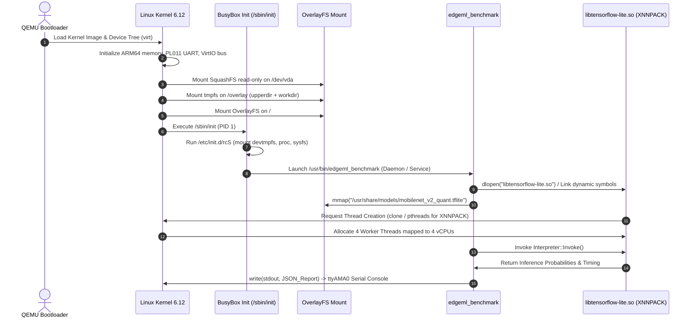
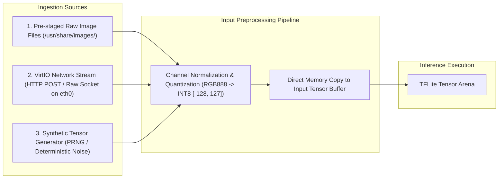
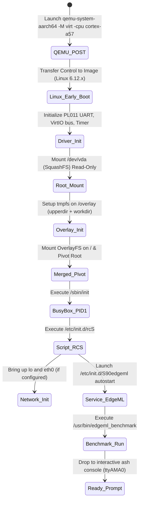
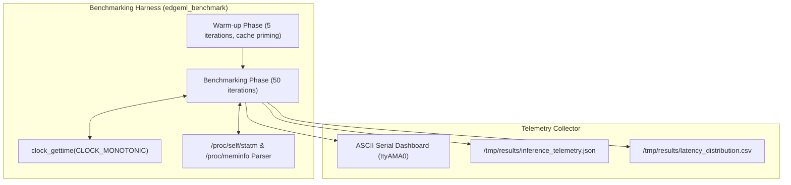

# System Architecture Specification
**Project:** EdgeML Linux OS  
**Distribution Track:** Track A – ML Inference at the Edge  
**Target Platform:** ARM64 (`aarch64` QEMU `virt` machine, Cortex-A57)  
**Build System:** Buildroot 2025.02.10  
**Document Reference:** `documentation/SYSTEM_ARCHITECTURE.md`  
**Date:** November 19, 2026  

---

## 1. Architectural Overview & System Goals

EdgeML Linux OS is a specialized, headless, ultra-lightweight, and immutable Linux operating system engineered exclusively for deterministic, high-throughput machine learning inference on resource-constrained 64-bit ARM embedded devices.

The architecture eliminates general-purpose desktop daemons, multi-user managers, and graphical display pipelines, replacing them with a streamlined, single-purpose runtime environment executing on a hardware-isolated, read-only root filesystem augmented by an in-memory OverlayFS.

```mermaid
flowchart TD
    subgraph HW_Layer["Virtual Hardware Platform (QEMU virt ARM64)"]
        CPU["Cortex-A57 (4 vCPUs, ARMv8-A + NEON SIMD)"]
        RAM["System Memory: 1024 MB RAM"]
        UART["PL011 UART Serial (ttyAMA0)"]
        VIRTIO_BLK["VirtIO Block Device (/dev/vda)"]
        VIRTIO_NET["VirtIO Network Device (eth0)"]
    end

    subgraph Kernel_Layer["Linux Kernel 6.12.x (Tailored Minimal ARM64)"]
        K_CORE["Kernel Core & Process Scheduler (SCHED_NORMAL / SCHED_FIFO)"]
        K_MEM["Memory Management & Page Allocator (SLUB)"]
        K_VIRTIO["VirtIO Drivers (blk, net, console)"]
        K_FS["In-Tree Filesystem Drivers (OverlayFS, SquashFS, ext4, tmpfs)"]
        K_NEON["Kernel Mode NEON & Crypto Extensions"]
    end

    subgraph Storage_Layer["Storage & Immutability Layer (OverlayFS)"]
        LOWER["Lowerdir: Read-Only SquashFS (/ro_root)"]
        UPPER["Upperdir: In-Memory tmpfs (/overlay/upper)"]
        WORK["Workdir: In-Memory tmpfs (/overlay/work)"]
        MERGED["Merged Root (/)"]
    end

    subgraph Userland_Layer["EdgeML Userland & Runtime"]
        BUSYBOX["BusyBox 1.36+ (Init, ash, coreutils)"]
        RCS["Init System: /etc/init.d/rcS"]
        GLIBC["GNU C Library (Glibc 2.39+) & Libstdc++"]
        TFLITE["TensorFlow Lite 2.14+ (libtensorflow-lite.so)"]
        XNNPACK["XNNPACK & RUY NEON Micro-Kernels"]
    end

    subgraph App_Layer["Inference & Telemetry Application"]
        INPUT["Input Ingestion Engine (Raw RGB / Synthetic / File)"]
        APP["EdgeML Inference Harness (/usr/bin/edgeml_benchmark)"]
        MODEL["Quantized Model: MobileNetV2 INT8 (/usr/share/models/)"]
        OUTPUT["Output Telemetry (Console / JSON / Syslog / File)"]
    end

    HW_Layer --> Kernel_Layer
    Kernel_Layer --> Storage_Layer
    Storage_Layer --> Userland_Layer
    Userland_Layer --> App_Layer
```



---

## 2. Kernel, Filesystem, Runtime, and Application Communication

The interactions between the underlying Linux kernel, the immutable root filesystem, the shared ML runtime libraries, and the userland inference application are defined through deterministic standard POSIX interfaces.



### 2.1 Virtual Memory & Model Mapping
* **Zero-Copy FlatBuffer Loading**: The inference application utilizes `tflite::FlatBufferModel::BuildFromFile()`. This issues an `mmap()` syscall directly against `/usr/share/models/mobilenet_v2_quant.tflite`.
* Because the underlying SquashFS lower directory is immutable and block-cached by the Linux kernel page cache, model weights are paged into memory on-demand without memory copying or heap duplication.
* **Deterministic Tensor Arena**: At startup, `edgeml_benchmark` allocates a contiguous **4 MB** heap buffer (`tflite::InterpreterBuilder` tensor arena). All intermediate activations, scratchpads, and quantized tensors are mapped within this single arena, completely preventing heap fragmentation during 24/7 inference loops.

---

## 3. Input Ingestion Architecture

In headless edge environments, inputs can arrive via multiple deterministic vectors. EdgeML Linux OS implements a flexible 3-tier input ingestion pipeline:



1. **Pre-Staged Test Images**: The rootfs overlay stages standard evaluation tensors (e.g., normalized 224x224x3 RGB image files) in `/usr/share/images/test_image.raw`. The application directly reads these bytes into the input tensor buffer.
2. **Synthetic Deterministic Tensors**: For rigorous system benchmarking without filesystem I/O jitter, the application generates pseudo-random Gaussian or deterministic test tensors in-memory, isolating pure ML mathematical compute latency from disk latency.
3. **Network Ingestion (VirtIO-Net)**: A lightweight listening daemon receives binary image payloads over a POSIX TCP socket on port 8080, copies the payload into the tensor arena, triggers inference, and returns JSON classification results over the socket.

---

## 4. Inference Output & Telemetry Visualization

EdgeML Linux OS operates headlessly. Output telemetry is displayed and recorded via four complementary channels:

1. **Standard Output (Serial Console - `/dev/ttyAMA0`)**:
   - Human-readable ASCII performance dashboard:
     ```
     ==============================================================
                    EdgeML Linux OS - Inference Engine
     ==============================================================
     Target Architecture: aarch64 (Cortex-A57, 4 vCPUs)
     ML Framework:        TensorFlow Lite 2.14+ (XNNPACK NEON)
     Model:               MobileNetV2 INT8 (224x224x3)
     --------------------------------------------------------------
     Inference Iteration: 50 / 50
     Latency (Cold Start): 42.15 ms
     Latency (Average):    78.34 ms
     Latency (p95):        81.12 ms
     Throughput:          12.76 FPS
     Top-1 Class:         285 (Egyptian Cat) - Confidence: 87.4%
     Memory (RSS):        23.8 MB (Peak Arena: 4.1 MB)
     ==============================================================
     ```
2. **Machine-Readable JSON Telemetry**:
   - Written to `/tmp/results/inference_telemetry.json` (inside the volatile OverlayFS upperdir):
     ```json
     {
       "device": "qemu_aarch64_virt",
       "runtime": "tflite_xnnpack",
       "threads": 4,
       "model": "mobilenet_v2_quant.tflite",
       "iterations": 50,
       "latency_avg_ms": 78.34,
       "latency_min_ms": 76.12,
       "latency_max_ms": 84.50,
       "latency_p95_ms": 81.12,
       "throughput_fps": 12.76,
       "memory_rss_kb": 24371,
       "status": "SUCCESS"
     }
     ```
3. **System Logging (Syslog)**:
   - Kernel and application events logged via BusyBox `klogd` / `syslogd` to `/var/log/messages`.

---

## 5. CPU-Only Inference Engineering (No Physical GPU)

Because physical GPU hardware is unavailable on our virtualized ARM64 platform:
1. **ARM NEON Vector SIMD Acceleration**:
   - ARM64 architecture provides mandatory 128-bit NEON vector registers (`v0`–`v31`).
   - The ML runtime is compiled with `-march=armv8-a -mtune=cortex-a57` and `-O3`.
   - Convolution and matrix multiplication loops vectorize across 16 INT8 elements simultaneously per vector instruction (`sdot` / vector multiply-accumulate).
2. **XNNPACK Execution Engine**:
   - XNNPACK is integrated directly into TensorFlow Lite. It provides assembly-level micro-kernels specifically written for ARMv8-A CPU cores.
   - It bypasses generic C++ matrix loops, scheduling quantized dot-product kernels directly onto the Cortex-A57 dual-issue execution pipelines.
3. **Thread Pool Optimization**:
   - The QEMU platform is configured with **4 vCPUs** (`-smp 4`).
   - TFLite creates a thread pool of 4 worker threads pinned to CPU cores, enabling multi-threaded parallel execution across spatial dimensions of convolutional layers.

---

## 6. Startup Sequence & Boot State Machine



### Startup Flow Details:
1. **Phase 1: Kernel Cold Initialization** (0.00 s – 0.95 s): Kernel decompresses and initializes page tables, interrupts (GICv3), timers, and VirtIO devices.
2. **Phase 2: Root & Overlay Assembly** (0.95 s – 1.25 s): The root partition is mounted read-only. A volatile RAM `tmpfs` is mounted at `/overlay`, and the union mount presents an ephemeral writable environment.
3. **Phase 3: BusyBox System Init** (1.25 s – 1.60 s): `/sbin/init` executes `/etc/init.d/rcS`. Essential virtual filesystems (`/proc`, `/sys`, `/dev/pts`, `/dev/shm`) are mounted.
4. **Phase 4: ML Service Autostart** (1.60 s – 2.50 s): `/etc/init.d/S90edgeml` triggers `edgeml_benchmark`. Model weights are verified, the tensor arena is allocated, and the benchmark executes.

---

## 7. Application Service Dependencies & Lifecycle

The EdgeML daemon lifecycle is managed via lightweight SysV-style init scripts in `/etc/init.d/`:

| Service Script | Execution Order | Prerequisites | Responsibility |
| :--- | :--- | :--- | :--- |
| `S10mountall` | Priority 10 | Kernel VFS | Mounts `/proc`, `/sys`, `/dev`, devpts |
| `S20overlay` | Priority 20 | `S10mountall` | Verifies OverlayFS mounts and creates `/tmp`, `/var/log` |
| `S30syslog` | Priority 30 | `S20overlay` | Starts BusyBox `syslogd` and `klogd` for kernel telemetry |
| `S40network` | Priority 40 | `S20overlay` | Configures loopback interface (`lo`) and virtio-net (`eth0`) |
| `S90edgeml` | Priority 90 | `S40network` | Executes `/usr/bin/edgeml_benchmark` and logs telemetry |

---

## 8. Benchmarking Architecture & Telemetry Pipeline

The benchmarking suite is structured to deliver scientifically reproducible performance telemetry without relying on third-party python dependencies:



* **High-Precision Timing**: Utilizes Linux `clock_gettime()` with `CLOCK_MONOTONIC` to achieve sub-microsecond timing resolution unaffected by system wall-clock adjustments.
* **Telemetry Extraction**:
  - `Latency_Mean`: $\frac{1}{N} \sum_{i=1}^{N} t_i$
  - `Throughput_FPS`: $\frac{1000}{\text{Latency\_Mean\_ms}}$
  - `Peak_RSS`: Peak Resident Set Size extracted from `VmHWM` in `/proc/self/status`.
