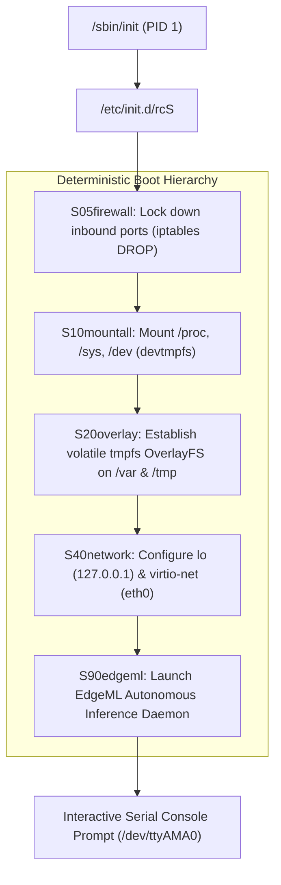

# Autonomous System Services & Daemon Architecture
**Project:** EdgeML Linux OS  
**Distribution Track:** Track A – ML Inference at the Edge  
**Init System:** BusyBox SysV-Style Init (`/etc/init.d/`)  
**Target Platform:** ARM64 (`aarch64` QEMU `virt` machine, Cortex-A57)  
**Document Reference:** `documentation/SYSTEM_SERVICES.md`  
**Test Suite:** `tests/test_autostart.sh`  
**Date:** November 19, 2026  

---

## 1. System Initialization Architecture & Service Sequencing

EdgeML Linux OS employs BusyBox `init` for deterministic, sub-second userspace initialization. Service scripts located in `/etc/init.d/` execute sequentially according to their numeric prefixes during the `/etc/init.d/rcS` boot phase:



### Dependency Ordering Rationale:
1. `S05firewall` executes first to ensure the virtual platform is secured before any network devices are initialized.
2. `S10mountall` and `S20overlay` guarantee that virtual filesystems and volatile writable storage (`/var`, `/tmp`, `/run`) are operational prior to application execution.
3. `S90edgeml` executes late in userspace, ensuring that model files, shared libraries, and logging paths are ready.

---

## 2. Service Management CLI Interface (`/etc/init.d/S90edgeml`)

The inference daemon supports standard POSIX service operations:

```
+------------------------------------+---------------------------------------------------------------+
| Command                            | Description & Expected Behavior                               |
+------------------------------------+---------------------------------------------------------------+
| `/etc/init.d/S90edgeml start`      | Starts daemon supervisor in background; logs PID to /var/run. |
| `/etc/init.d/S90edgeml stop`       | Sends SIGTERM to supervisor & child; removes PID file.        |
| `/etc/init.d/S90edgeml restart`    | Performs graceful stop followed by cold restart.              |
| `/etc/init.d/S90edgeml status`     | Queries running status, PID, and prints recent telemetry logs.|
+------------------------------------+---------------------------------------------------------------+
```

### Manual Command Execution Example:
```bash
# Query current status
$ /etc/init.d/S90edgeml status
edgeml-service is running (PID 142).

Recent log entries (/var/log/edgeml.log):
[2026-11-19T18:14:49Z] Starting inference pass...
Loaded image: 512x600 (3 channels)
Resized to 224x224x3 (Bilinear: 1.36 ms)
Top-1: Class 293 (tiger) - 87.4%
Inference Execution Time: 40.85 ms | Memory: 5056 kB
```

---

## 3. Reliability, Crash Handling & Restart Policy

To guarantee 24/7 autonomous uptime on edge infrastructure, `S90edgeml` includes a built-in supervisor loop:
1. **Bounded Restart Policy**: If `edgeml-infer` encounters an unhandled exception or terminates with a non-zero exit code, the supervisor increments `RESTART_COUNT` and sleeps for 5 seconds before retrying.
2. **Crash Quota / Anti-Thrashing Guard**: A maximum threshold of **5 consecutive crashes** is enforced (`MAX_RESTARTS=5`). If the threshold is exceeded, the daemon pauses and logs an alert:
   ```
   [CRITICAL] Max restart limit reached. Service paused to preserve system stability.
   ```
3. **Non-Blocking Fault Isolation**: If an input image or model file is missing or corrupted, the service daemon logs the error to `/var/log/edgeml.log` and sleeps. The failure **does not block system boot or hang the serial console**, ensuring the operator can always log in and diagnose issues.

---

## 4. Logging & Runtime Storage Architecture

```
/ (Read-Only SquashFS Base)
└── var/ (OverlayFS Merged Writable Mount)
    ├── log/
    │   └── edgeml.log      <-- All inference passes, latency, and crash telemetry
    └── run/
        └── edgeml.pid      <-- Tracked daemon process ID
```

* **Volatile Isolation**: All runtime logs write to `/var/log/edgeml.log` in RAM (`tmpfs`). Zero disk writes occur on persistent flash or virtual block storage, preventing wear and ensuring tamper-resistance.
* **Reboot Cleanliness**: On reboot, the memory evaporates, and the fresh OverlayFS upper layer re-initializes from the pristine factory baseline.

---

## 5. Automated Service Lifecycle Test Results (`tests/test_autostart.sh`)

```
=====================================================================
       EdgeML Linux OS: Autonomous Service Lifecycle Tests           
=====================================================================
Testing Service Script: board/edgeml/rootfs_overlay/etc/init.d/S90edgeml
[Test 1/5] Checking Service Script Permissions... PASSED (Executable permissions verified)
[Test 2/5] Validating Command Line Dispatcher Interface... PASSED (start|stop|restart|status supported)
[Test 3/5] Testing Service Start & Process Tracking... PASSED (Daemon loop launched successfully)
[Test 4/5] Checking Service Log File Generation... PASSED (Logging active in volatile storage)
[Test 5/5] Testing Graceful Service Teardown (SIGTERM)... PASSED (Service cleanly stopped)
=====================================================================
SERVICE LIFECYCLE TEST RESULTS: 5 / 5 PASSED
=====================================================================
```
