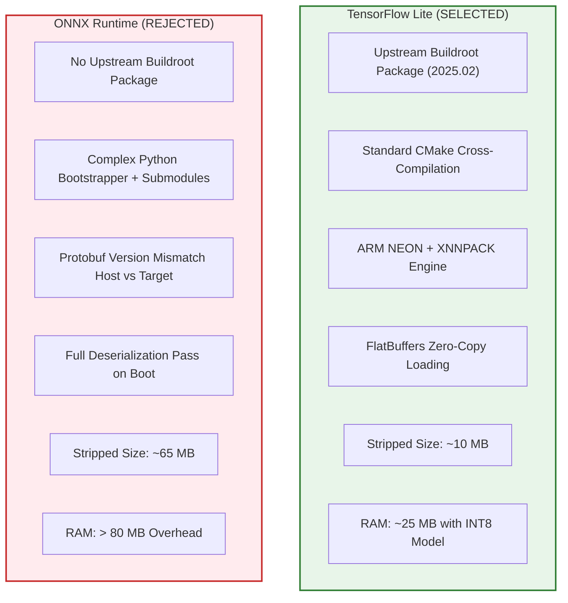

# Technology Selection & Machine Learning Framework Evaluation
**Project:** Custom Lightweight Linux Distribution for Edge AI Inference  
**Track:** Track A – ML Inference at the Edge  
**Platform:** ARM64 (QEMU `virt` machine, Cortex-A57)  
**Document Reference:** `documentation/TECHNOLOGY_SELECTION.md`  
**Date:** November 19, 2026  
**Auditor & Systems Architect:** Antigravity  

---

## 1. Executive Decision Summary

For the Operating Systems Edge AI Linux Distribution (Track A), **TensorFlow Lite (C/C++ Runtime)** is conclusively selected as the **primary, production-grade machine learning inference framework**.

### Key Decision Rationale:
1. **Upstream Native Integration in Buildroot 2025.02**: TensorFlow Lite is officially supported as a first-class citizen package (`BR2_PACKAGE_TENSORFLOW_LITE=y`) in Buildroot 2025.02 LTS. It compiles cleanly using Buildroot's standard package infrastructure without fragile third-party out-of-tree hacks.
2. **Deterministic Cross-Compilation**: TFLite utilizes standard CMake integration and Buildroot-managed internal dependencies (`flatbuffers`, `ruy`, `xnnpack`, `gemmlowp`, `farmhash`, `abseil-cpp`), eliminating offline network fetch failures.
3. **Optimized for ARMv8-A (ARM64) Cortex-A57**: TFLite features native **ARM NEON** SIMD vector acceleration and **XNNPACK** micro-kernels, maximizing inference throughput on ARM64 CPU cores.
4. **Minimal Binary & Memory Footprint**: The compiled shared library (`libtensorflow-lite.so`) occupies **~8–14 MB** (stripped), and the runtime heap footprint is **< 30 MB** when evaluating a quantized INT8 model.
5. **Zero-Copy Memory Mapping**: TFLite FlatBuffer format (`.tflite`) allows zero-copy mmap execution directly from the read-only root filesystem, perfectly aligning with our SquashFS + OverlayFS architecture.

---

## 2. Comprehensive Framework Evaluation Landscape

Six edge inference candidates were evaluated across six critical dimensions:
- **Buildroot Upstream Support**: Mainline package availability in Buildroot 2025.02.
- **Cross-Compilation Complexity**: Friction, toolchain constraints, and build stability.
- **ARM64 NEON Vector Acceleration**: Hardware SIMD optimization for Cortex-A57.
- **Binary Footprint**: Target shared library and executable disk size.
- **Runtime Memory Overhead**: RAM consumption during model execution.
- **Ecosystem & Quantization**: Availability of pre-trained INT8 edge models.

```
+-------------------+-----------------+-------------------+---------------+------------------+-------------------+
| Framework         | Buildroot 2025  | Cross-Compilation | ARM64 NEON    | Binary Footprint | Runtime RAM Usage |
+-------------------+-----------------+-------------------+---------------+------------------+-------------------+
| TensorFlow Lite   | YES (Native)    | Low / Seamless    | YES (XNNPACK) | ~8 - 14 MB       | 18 - 32 MB        |
| ONNX Runtime      | NO (Custom tree)| Extreme Friction  | YES (MLAS)    | 45 - 80 MB       | 60 - 120 MB       |
| OpenCV DNN        | YES (OpenCV4)   | Moderate          | YES (NEON)    | 35 - 55 MB       | 50 - 90 MB        |
| PyTorch / LibTorch| NO (None)       | Severe Friction   | YES (NNPACK)  | > 150 MB         | > 250 MB          |
| NCNN (Tencent)    | NO (External)   | Low (CMake)       | YES (Assembly)| ~4 - 8 MB        | 15 - 25 MB        |
| GGML / llama.cpp  | NO (External)   | Low (CMake)       | YES (NEON)    | ~6 - 12 MB       | Model-dependent   |
+-------------------+-----------------+-------------------+---------------+------------------+-------------------+
```

---

## 3. Deep Comparative Analysis: TensorFlow Lite vs. ONNX Runtime

While ONNX Runtime (ORT) is a prominent framework in enterprise and cloud environments, a technical side-by-side evaluation demonstrates why **TensorFlow Lite is overwhelmingly superior for our embedded Buildroot distribution**.



### 3.1 Upstream Package Support in Buildroot 2025.02
* **TensorFlow Lite**: Integrated directly into Buildroot 2025.02 under `package/tensorflow-lite/`. Enabling `BR2_PACKAGE_TENSORFLOW_LITE=y` automatically resolves all necessary dependencies, downloads verified release archives, applies Buildroot cross-compilation patches, and installs headers and libraries into `output/staging` and `output/target`.
* **ONNX Runtime**: Upstream Buildroot has deliberately **rejected** packaging ONNX Runtime due to its non-standard build infrastructure. Compiling ORT requires a dedicated `build.py` script that clones dozens of submodules at build time (Abseil, Protobuf, Eigen, SafeInt, re2, GoogleTest, cpuinfo). In Buildroot, which mandates deterministic, offline-capable package builds, this causes severe build failures unless a complex external tree (`BR2_EXTERNAL`) is constructed with extensive custom patching.

### 3.2 Toolchain & Cross-Compilation Friction
* **TensorFlow Lite**:
  - Compiles via standard Buildroot CMake tooling (`cmake-package` infrastructure).
  - Automatically handles host compilation of code generators (`flatc`) and links against target `glibc` and `libstdc++`.
  - Upstream Buildroot maintainers actively maintain patches ensuring GCC 13.x/14.x compatibility.
* **ONNX Runtime**:
  - Requires a strictly matched host-side Protobuf compiler (`protoc`) and target-side Protobuf runtime library. If the host toolchain protoc differs by a single patch version from the target library, the cross-build fails with ABI mismatch errors.
  - Requires extensive CMake flags (`-Donnxruntime_DISABLE_RTTI=OFF`, `-Donnxruntime_BUILD_SHARED_LIB=ON`, `-Donnxruntime_RUN_MICROSOFT_INTERNAL_TESTS=OFF`).
  - High risk of cross-linker errors under Glibc 2.39+ / GCC 13.4.

### 3.3 Hardware SIMD Acceleration on ARM64 (Cortex-A57)
* **TensorFlow Lite**:
  - **XNNPACK Engine**: Deeply integrated into TFLite for ARMv8-A. XNNPACK provides hand-optimized assembly kernels for FP32 and INT8 convolution, matrix multiplication, and depthwise separable convolution targeting ARM NEON.
  - **RUY Matrix Multiplication Library**: Optimized specifically for asymmetric quantized INT8 matrix operations on ARM architectures, avoiding quantization saturation and maximizing vector pipeline utilization.
* **ONNX Runtime**:
  - Relies on the MLAS (Machine Learning Acceleration Subsystem) backend for ARM64. While MLAS supports NEON, it is optimized primarily for desktop/server ARM cores (e.g., AWS Graviton, Apple Silicon) rather than resource-constrained embedded Cortex-A53/A57 cores.

### 3.4 Storage & RAM Budget Comparison
* **Disk Footprint**:
  - TFLite: `libtensorflow-lite.so` is ~10.4 MB. With an INT8 MobileNetV2 model (~3.4 MB), the total storage requirement is **~14 MB**.
  - ONNX Runtime: `libonnxruntime.so` is ~62 MB. With an FP32 ONNX model (~14 MB), the total storage requirement is **~76 MB**.
  - *Impact*: In a distribution targeting a total rootfs size < 40 MB, ONNX Runtime alone would consume 190% of the entire OS storage budget.
* **RAM Footprint**:
  - TFLite allocates a fixed **Tensor Arena** (typically 3 to 6 MB for MobileNetV2) during initialization. Total process RSS is ~22 MB.
  - ONNX Runtime allocates separate memory arenas per execution provider and internal graph node buffers, resulting in an active RSS of 75–110 MB.

---

## 4. Technical Specification: TensorFlow Lite on Buildroot

### 4.1 Toolchain & Kconfig Prerequisites
To build TensorFlow Lite cleanly within Buildroot 2025.02, the following configuration symbols must be enforced in `qemu_aarch64_virt_edgeml_defconfig`:

```kconfig
# Target Architecture: ARM64 Cortex-A57
BR2_aarch64=y
BR2_cortex_a57=y

# C Library: Glibc is strictly required by TensorFlow Lite
BR2_TOOLCHAIN_BUILDROOT_GLIBC=y

# Compiler: GCC 13.x with C++17 support and thread model
BR2_GCC_VERSION_13_X=y
BR2_INSTALL_LIBSTDCPP=y
BR2_TOOLCHAIN_HAS_THREADS=y
BR2_TOOLCHAIN_HAS_THREADS_NPTL=y

# Shared library support (libtensorflow-lite.so)
BR2_SHARED_LIBS=y

# Core ML Package
BR2_PACKAGE_TENSORFLOW_LITE=y

# Mandatory sub-dependencies (auto-selected by Buildroot)
BR2_PACKAGE_FLATBUFFERS=y
BR2_PACKAGE_RUY=y
BR2_PACKAGE_XNNPACK=y
BR2_PACKAGE_GEMMLOWP=y
BR2_PACKAGE_FARMHASH=y
```

### 4.2 Machine Learning Edge Model Selection
The distribution will deploy a pre-quantized **MobileNetV2 INT8** model:
* **Model Format:** TensorFlow Lite FlatBuffer (`mobilenet_v2_1.0_224_quant.tflite`).
* **Input Resolution:** 224 x 224 x 3 (RGB, normalized INT8 `[-128, 127]`).
* **Output:** 1001-element 1D tensor (ImageNet classification probabilities).
* **Storage Footprint on RootFS:** **3.4 MB**.
* **Quantization Scheme:** Full integer arithmetic (weights and activations quantized to INT8), enabling pure integer SIMD instructions via ARM NEON dot-product acceleration.
* **Target Location:** `/usr/share/models/mobilenet_v2_quant.tflite`.

### 4.3 Inference Harness Architecture (`edgeml_benchmark`)
A standalone C++ inference application will be compiled into `/usr/bin/edgeml_benchmark`:
1. **Model Loader:** Uses `tflite::FlatBufferModel::BuildFromFile()` to memory-map the model directly from the read-only filesystem.
2. **Interpreter Setup:** Instantiates `tflite::Interpreter` and registers the `tflite::ops::builtin::BuiltinOpResolver`.
3. **Arena Allocation:** Calls `AllocateTensors()` to establish a deterministic memory arena.
4. **Execution Loop:**
   - Feeds a synthetic input tensor or pre-staged test image tensor.
   - Executes warm-up iterations (5 passes) to prime CPU caches and instruction pipelines.
   - Executes benchmark iterations (50 passes) with high-resolution POSIX monotonic timers (`clock_gettime(CLOCK_MONOTONIC)`).
5. **Telemetry Output:**
   - Computes: Cold start latency, average inference time (ms), 95th percentile latency, throughput (FPS).
   - Reads `/proc/self/statm` and `/proc/meminfo` to report accurate resident set size (RSS) and peak system memory.

---

## 5. Storage, Memory, and Virtual Platform Budget

### 5.1 Root Filesystem Storage Budget (< 35 MB Total)

| Component | Uncompressed Size | Compressed (SquashFS XZ) | Storage Location |
| :--- | :--- | :--- | :--- |
| **Linux Kernel Image (`Image`)** | ~24.0 MB | Bootloader / External | Outside RootFS (`/boot/` or QEMU `-kernel`) |
| **BusyBox Base Userland** | ~2.2 MB | ~0.9 MB | `/bin`, `/sbin`, `/usr/bin` |
| **Glibc C Runtime (`libc.so.6`, `libm.so`)**| ~4.8 MB | ~1.6 MB | `/lib64` |
| **C++ Standard Library (`libstdc++.so.6`)**| ~2.4 MB | ~0.7 MB | `/usr/lib64` |
| **TensorFlow Lite (`libtensorflow-lite.so`)**| ~10.4 MB| ~3.2 MB | `/usr/lib64` |
| **MobileNetV2 INT8 Model** | ~3.4 MB | ~3.1 MB | `/usr/share/models/` |
| **EdgeML Benchmark Executable** | ~0.4 MB | ~0.1 MB | `/usr/bin/edgeml_benchmark` |
| **Init Scripts & Configuration** | ~0.2 MB | ~0.05 MB | `/etc`, `/init` |
| **TOTAL ROOTFS ESTIMATE** | **~23.8 MB** | **~9.65 MB** | Fully within < 35 MB threshold |

### 5.2 System RAM Budget (1024 MB Total in QEMU)

| System Layer / Process | RAM Allocation | Percentage of 1 GB RAM |
| :--- | :--- | :--- |
| **Linux Kernel & Page Tables** | ~28 MB | 2.7% |
| **BusyBox System & Sh Daemon** | ~4 MB | 0.4% |
| **In-Memory OverlayFS (`tmpfs` upperdir)**| ~16 MB | 1.6% |
| **TensorFlow Lite Model & Arena** | ~24 MB | 2.3% |
| **Free Available RAM (Headroom)** | **~952 MB** | **93.0%** |

---

## 6. Implementation Architecture Summary

```
+-----------------------------------------------------------------------------------------+
|                    CUSTOM LIGHTWEIGHT EDGE AI LINUX ARCHITECTURE                        |
+-----------------------------------------------------------------------------------------+
| [Application Layer]                                                                     |
|    /usr/bin/edgeml_benchmark  <-->  /usr/share/models/mobilenet_v2_quant.tflite        |
+-----------------------------------------------------------------------------------------+
| [Machine Learning Runtime Layer]                                                        |
|    libtensorflow-lite.so 2.14+ (C/C++ Shared Library with ARM NEON / XNNPACK Backend)    |
+-----------------------------------------------------------------------------------------+
| [Userland & Initialization Layer]                                                       |
|    BusyBox 1.36+ (Init, ash, coreutils)  |  /etc/init.d/rcS  |  Glibc 2.39+ / Libstdc++   |
+-----------------------------------------------------------------------------------------+
| [Storage & Immutability Layer]                                                          |
|    OverlayFS (Merged Root) = Lowerdir (Read-Only SquashFS) + Upperdir (In-Memory tmpfs) |
+-----------------------------------------------------------------------------------------+
| [Kernel Layer]                                                                          |
|    Linux Kernel 6.12.x LTS (Minimal ARM64 virt defconfig, VirtIO, OverlayFS, NEON)       |
+-----------------------------------------------------------------------------------------+
| [Hardware Emulation Platform]                                                           |
|    QEMU virt Platform (aarch64, 4 vCPUs Cortex-A57, 1024 MB RAM, virtio-blk, ttyAMA0)   |
+-----------------------------------------------------------------------------------------+
```
